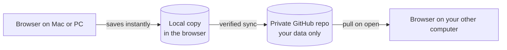

<div align="center">

# Ledger

**A quiet, local-first expense tracker.**
Log it, split it, see what is coming, and where the month and the year went.


[What it does](#what-it-does) · [How it works](#how-it-works) · [Make your own](#make-your-own-ledger) · [Privacy](#privacy-and-security) · [Changelog](CHANGELOG.md)

</div>

---

## What is Ledger?

Ledger is a personal expense tracker that replaced a spreadsheet. It does the handful of things that paid trackers each do only partly: log spending and income, show the history, summarize the month and the year, split costs with friends and family, follow credit cards to the centavo, and look ahead at your balance.

It runs in the browser, keeps your data on your own device first, and syncs between your computers through a private GitHub repository you own. There is no company server, no account to create, and nothing to subscribe to.

> Built for one person. Designed to read like a well-kept paper ledger: few words, large figures, fine rules instead of boxes, one blue for what you press. Light by default with a dark twin, a tab bar on phones and a two-pane layout on a wide screen.

**Getting started takes about 15 minutes:** copy the app, make a private repo for your data, connect. [Jump to the steps](#make-your-own-ledger).

---

## What it does

Ledger has five rooms, each named for the question it answers, plus Settings behind the gear at the top right. The look is called Folio: paper and ink, figures set in Spectral and everything else in Hanken Grotesk, with a dark twin and a text size setting. On a computer there is a top bar, the Ledger shows the list and the open entry side by side, and keyboard shortcuts cover the common moves.

### Add: what did I just spend?

One small card with a switch at the top: **Expense**, **Income** or **Transfer**.

- **Expense:** amount, then **Again** (your most repeated notes of the last 30 days; a tap fills the note, category and split, never the amount), note, category (four chips and More), account and date, **Split** (tap the people and who paid, and see who owes what before you save), then **Repeats** (no, recurring weekly, monthly or yearly, or in installments, "3 of 12"). Save stays in view on a phone.
- After Save you stay on Add, ready for the next one. A short message names what was saved, with **Undo** for 8 seconds (or until you close it, if you choose that in Settings).
- **Income:** money from other sources (Gift, Interest, Sale, Side Job, Spare Change, Other) into one of your bank accounts, in that account's currency. Salary is set in Coming up.
- **Transfer:** move money between two of your bank accounts in the same currency. Your total stays the same.
- Default accounts and a default category, or start with the last ones you used on this device. A first run shows a short checklist: name an account, set up sync, add a salary.

### Ledger: what happened?

Your history, newest first.

- Day, Week and Month views, Search, a category filter, and a Today button (or press T on a computer). Search one period or all months.
- Every day shows the full amount paid and, under it, your share. Every row shows what it was, its category colour and tags (split, refund, recurring, "7 of 12", upcoming). Money in is green with a plus; money out is plain. Split rows also show your share.
- One line at the top points to Coming up with how many payments are due in the next 30 days.
- Tap anything to edit it: expenses, income, refunds, transfers and card payments. For a plan, change one payment or this and every later one, skip one, end the series, or **Edit plan** (start date, how often, payments and total, end date) with a preview of what changes before you save.
- Delete asks for a second tap, and Undo brings it back. Refund a card expense from its edit sheet.

### Dashboard: how is the month?

A **Month** and **Year** switch at the top.

- **Spent** this month (your share of splits) with a thin line against the same days last month, **Still due** (yours, rest of the month), and **Last month**.
- Categories as one strip with a legend. Tap a part or a legend row for its largest items. A calendar of days lit by how much you spent; tap a day to open it in the Ledger. For the current month the charts also count what is still scheduled, marked "incl. upcoming". A later month shows what is **Planned**.
- Filter the spending figures to one bank account or card.
- **Credit cards:** each card shows its statement, due date, unbilled charges, credit left and installment holds. Pay the statement, pay everything, or pay ahead from a bank account in one tap.
- **Accounts** with your total, what it would be if everyone paid you back, and after your card bills. **Owed to you**, person by person. The forecast for the end of next month.
- **Card view:** tap a card for its statement line by line, what is unbilled, and its plans, plus **Reconcile** to compare with your bank app.
- **Year:** spent, income and net for the year so far or a past year, a month by month chart, your top categories, the average, highest and lowest month, and the same dates last year.

### People: who owes whom?

- Balances per person, in each currency, with each statement line's running balance.
- Split modes: they owe it all, you owe it all, even (everyone pays the same), or custom amounts for 3 or more people.
- **Settle up:** all of it, or part of it (the most you can record is the balance), with Undo. After a part payment the unpaid lines stay in view.
- **Snapshot:** turn a person's balance into a clean statement image (Date, Item, Total, Your share) to copy or save and send.

### Coming up: what is next, and can I cover it?

- **Soon:** what leaves your bank in the next 30 days. Card bills on their due dates (an estimate until the statement closes), payments straight from a bank, charges scheduled on cards and the bill each lands on, and what people owe you.
- **12 months:** your balance projected 3, 6 or 12 months ahead, with what it assumes said in words, the month table, and your salary per month (repeat it every month and pick the bank it is paid into).
- **Plans:** every recurring payment and installment plan, with the next date, account and payments left, and what they cost you a month.

### Settings (the gear)

- A **Data health** card on top says whether your data is safe on GitHub or backed up, and when your token needs renewing. The gear shows a small dot when something there needs you.
- **General:** currency, appearance (Light, Dark, or Auto), text size (Default, Large, Larger), keeping Undo until dismissed, and keyboard shortcuts on a computer (N new, / search, [ and ] previous and next, T today).
- **Accounts:** bank accounts and credit cards (named before they are created), card colours, defaults. Removing an account that is in use offers to move its entries and plans first, and removed accounts can be restored.
- **People and categories.**
- **Sync and backup:** connect GitHub, export everything as one file or a spreadsheet, and import a backup (nothing is deleted on import).

### Also

- **Multi-currency.** PHP by default. A foreign expense keeps its original amount and the rate you entered, so history never shifts.
- **Works offline,** and installs as an app from your browser's menu.
- **Gentle motion** that turns into simple fades when your device asks for reduced motion.

---

## What it does not do

Ledger stays small on purpose. It does **not**:

- connect to banks or import bank feeds
- scan receipts
- set budgets or savings goals
- support multiple users or shared accounts
- ship a native mobile app or send notifications
- track investments
- store account or card numbers
- work out card interest, late fees or minimum payments (it assumes you pay the full statement)
- look up exchange rates online (you type the rate)
- run a server, require a login, or cost money

---

## How it works



**Local first.** Every change is saved in your browser right away, so the app works offline.

**Two repositories.** The app code lives in this public repo and is served as a static site. Your data lives in a separate private repo that only you can read. Code and data never mix.

**One writer at a time.** You use one computer at a time, so Ledger treats sync as a handoff, not live merging. On open it checks for newer data and downloads it first. After saving it pushes your changes and confirms they landed before showing "Synced". If both computers changed, you choose which version to keep, or merge them, and the version you did not keep is saved to your Downloads first. While offline, Ledger is read-only unless you choose to edit anyway.

**Plain files.** Data is stored as readable JSON, one file per month, with money kept as whole centavos to avoid rounding errors. Totals, balances and forecasts are worked out when you open a screen and never stored. Git history doubles as your backup.

---

## Make your own Ledger

Ledger has no company behind it and no shared server, so **each person runs their own copy** with their own two GitHub repos. Nothing is shared with the author or with anyone else. It costs nothing.

**What you need:** a free [GitHub](https://github.com) account and a modern browser (Chrome, Edge, Safari or Firefox). You do not need to install anything or write code.

| Repo | Visibility | What it holds |
|---|---|---|
| **App** (your copy of this project) | Public | Code only. GitHub Pages needs a public repo on a free account. It never holds your data. |
| **Data** (yours alone) | **Private** | Your entries, as small JSON files. |

> The author's own copy is live at https://seanabasta.github.io/ledger-web-app/ as a personal instance. Making your own copy is still the safest route: you decide what code runs with your token, and updates happen when you choose. If you know and trust the author and do not want to keep a copy, you can use this one instead with your own private data repo and your own token (steps 2 and 3 below). Your data stays in your browser and your repo, and the author never sees it. You get each update as soon as it is deployed, so you need to trust the code that is deployed there.

### 1. Make your own copy of the app

The easiest way is a fork, which needs no command line.

1. Sign in to GitHub and click **Fork** at the top of this page. Keep the name or choose your own.
2. In your fork, open the **Actions** tab and click the green button to enable workflows. GitHub turns them off on forks by default.
3. In your fork, go to **Settings, then Pages**, and set **Source** to **GitHub Actions**.
4. Back in the **Actions** tab, open **Deploy to GitHub Pages** and click **Run workflow**. When it turns green your app is live at `https://<your-username>.github.io/<your-fork-name>/`. Bookmark it.

<details>
<summary>Prefer the command line? Make a clean copy instead of a fork</summary>

Create an empty public repo on GitHub, then:

```bash
git clone https://github.com/SeanAbasta/ledger-web-app.git my-ledger
cd my-ledger
git remote set-url origin https://github.com/<your-username>/<your-repo>.git
git push -u origin main
```

Then do steps 2 to 4 above (enable Actions if asked, set Pages to GitHub Actions, run the workflow).

</details>

### 2. Make your private data repo and token

1. Create a new **private** repo for your data. Any name works, and a hard-to-guess one is a nice touch. Tick "Add a README" so it has a first commit.
2. On GitHub go to **Settings, Developer settings, Personal access tokens, Fine-grained tokens, Generate new token**.
3. Resource owner: you. **Expiration:** a date within a year, and write it down.
4. Repository access: **Only select repositories**, and choose **only your data repo**.
5. Permissions: **Contents: Read and write**. Nothing else.
6. Generate the token and copy it once. You cannot see it again.

### 3. Connect your computers

1. Open your app link, click the status pill in the top corner (it says "Set up sync"), then **Connect GitHub**. The same setup is in Settings, behind the gear at the top right.
2. Enter your GitHub username, your data repo name, the token and its expiry date, then **Verify**.
3. Do the same on your other computer. It downloads everything on first open.

That is all. Add entries as normal and Ledger pushes them to your data repo a few seconds after each change.

### Every day

1. Open Ledger and wait for "Checking for updates…" to finish and the pill to say **Synced**.
2. Work as usual.
3. Before closing, click the pill, press **Sync now**, and wait for **Synced. Safe to close.** Then close the tab, and use your other computer the same way.

### Keeping your copy up to date

Your copy does not update by itself. When the author releases fixes or new features, **update your copy to get them**:

- **Forked:** on your fork's page, click **Sync fork, then Update branch**. The site rebuilds and redeploys on its own in about a minute.
- **Cloned:** pull the new changes into your copy, then push to your repo.

Then reload the app (and accept the update if you installed it as an app). An update only replaces the app's code. It does not change your data repo or your browser's copy. If a release ever has to change how data is stored, the release notes will say what to do. V2.0.0 stores no new kinds of data, so an older copy keeps working with everything you save. Update both computers so they show the same screens. See [CHANGELOG.md](CHANGELOG.md) for what changed in each version.

### Will my copy use the author's GitHub limits?

No. Your copy is your own repo on your own account, so its site size, bandwidth and build limits are yours. Your data goes from your browser to your private repo using your own token, so it counts against your own API limits. For one person this is nowhere near any limit: the app is a few hundred kilobytes, and a month of entries is tens of kilobytes.

### When something goes wrong

| What you see | What it means | What to do |
|---|---|---|
| **Token expired** | The token reached its expiry date, or was revoked. The Data health card in Settings warns you ahead of time. | Create a new token (step 2), then the gear, Settings, **Replace token**, on each computer. Your data is safe on the device meanwhile. |
| **Two versions of your ledger** | Both computers changed since they last synced. Nothing is lost. | Choose **Merge** (recommended), Keep this device, or Keep GitHub's version. The version you do not keep is saved to your Downloads first. |
| **Offline, read-only** | No connection. Ledger holds back edits so your other computer's data stays safe. | Reconnect and press Retry, or choose Edit offline if you are sure. |
| **Needs sync** that does not clear | A push failed (rate limit, network). | Click the pill, then Sync now. It retries by itself too. |
| **No access to the data repo** | The token cannot reach that repo. | Check the repo name, and that the token is limited to that repo with Contents read and write. |
| **Pages shows a 404** | Pages is not on yet. | Settings, Pages, Source: GitHub Actions, then run the workflow again. |
| **Workflow will not run on a fork** | GitHub disables Actions on forks. | Open the Actions tab and enable workflows. |
| **Browser data cleared** | Ledger's local copy is gone. | Open Ledger and it downloads everything again from your data repo, or use the gear, Settings, **Import** with a backup file. |
| **A dot on the gear** | Something in Data health needs you: no backup lately, or a token close to expiry. | Open Settings and read the Data health card at the top. |

Back up now and then with the gear, Settings, **Backup file**. The data repo's history is a backup too: GitHub keeps every earlier version.

---

## Privacy and security

- Your data stays in your browser and in a private repo you control.
- The app has no analytics, no third-party scripts, and a strict Content Security Policy that only allows talking to `api.github.com`.
- The fonts ship with the app. Nothing is loaded from a font service or any other site.
- The service worker caches only the app's own files, never your data and never requests to GitHub.
- Sync uses a GitHub token limited to the data repo only, stored in your browser. Anyone with access to that browser profile, or any malicious script on the page, could use it, so keep your devices locked.
- A private repo is still stored on GitHub's servers. Do not put anything in Ledger you would not trust to a private repository.
- Never commit tokens or data to this repo. The deploy workflow fails if the build contains something that looks like a token.

---

## Status

Ledger is deployed and in daily use. Sync between a Mac and a Windows PC has been confirmed against a real GitHub repo. The latest version is **V2.0.1**. It is still a personal project, so keep a backup.

**Ledger is feature complete as of V2.0.0.** It does what it set out to do, and no new features are planned. Later releases will be patches: bug fixes and small quality of life improvements.

| Version | Highlights |
|---|---|
| **V2.0.1** | A new icon, Undo no longer refills Add later, clearer wording |
| V2.0.0 | Ledger 2: People and Coming up (what leaves your bank next), Undo, part settle, Again chips, Edit plan, Data health, the Folio look, text size, a two-pane layout and shortcuts on a computer |
| V1.4.1 | A new look, Anodized: silver and space black, a ring gauge around Spent, a calendar of days, drawn icons |
| V1.4.0 | Faster logging: stay on Add, category buttons, split preview, search all months, your share on split rows, a second tap to delete |
| V1.3.1 | One-off income, transfers between bank accounts, Recurring list, planned spending in the chart, Year report, full prices on split statements |
| V1.3.0 | Tap to pick people in splits, Ledger category filter, Dashboard account filter, tap the chart for a breakdown, Forecast chart for 3, 6 or 12 months |
| V1.2.4 | Safer removing of accounts and cards (move, restore, fix), edit card payments, salary "Paid into" |
| V1.2.2 | A new look: grouped background, rounded figures, bottom tab bar on phones, card colours |
| V1.2.0 | Card statements, Reconcile with the bank, Pay all, default accounts, motion |
| V1.1.0 | Credit cards, transfers, refunds, card bills in the forecast |
| V1.0.x | First release, dark mode, editing, Owed to you |

Full notes for every version are in [CHANGELOG.md](CHANGELOG.md).

---

## Built with

- **React** and **TypeScript**, bundled with **Vite**
- **IndexedDB** for the local working copy
- **GitHub REST API** (Git Data) for sync
- **GitHub Pages** and **GitHub Actions** for hosting
- **Vitest** for the tests (more than 500 of them, run before every deploy)
- **Spectral** and **Hanken Grotesk**, self-hosted and trimmed to the characters the app uses

Built with Claude Code.

---

## Run it locally (for developers)

You do not need this to use Ledger. It is for changing the code. You need [Node.js](https://nodejs.org). Then:

```bash
git clone https://github.com/SeanAbasta/ledger-web-app.git
cd ledger-web-app
npm install
npm run dev
```

Open the address the terminal prints, plus the app path: usually `http://localhost:5173/ledger-web-app/`.

Other commands:

```bash
npm test          # run the tests
npm run build     # type check and production build into dist/
npm run preview   # serve the production build locally
```

---

## License

This is a personal project. No license has been chosen yet, so all rights are reserved.

The app ships two fonts, Spectral and Hanken Grotesk, under the SIL Open Font License 1.1 (texts in [LICENSES](LICENSES/)).
