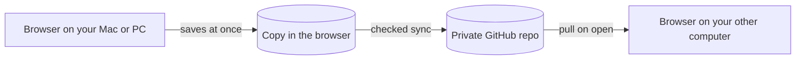

# Ledger

A personal expense tracker that runs in the browser. It replaced a spreadsheet.

Your data is kept in your browser first and synced between your computers through a private GitHub repository that you own. There is no server run by anyone else, no account to create and nothing to pay for.

Latest version: V2.0.3. [Changelog](CHANGELOG.md).

Ledger is finished as far as features go. Later releases are fixes and small improvements.

## What it does

Ledger has five screens and a Settings page behind the gear at the top right. On a phone the five screens are a tab bar. On a computer they are a top bar, and the Ledger shows the list and the open entry side by side.

The look is paper and ink: figures in Spectral, everything else in Hanken Grotesk, light by default with a dark theme and three text sizes. Motion becomes a plain fade if your device asks for less of it.

### Add

An Expense, Income or Transfer switch sits at the top.

- **Expense:** amount, note, category, account and date. You can split it between people (tap who is in it and who paid, and see who owes what before you save), and make it repeat weekly, monthly or yearly, or spread it over a number of installments.
- **Again:** your most repeated notes from the last 30 days, shown as chips. A tap fills the note, category and split. It never fills the amount.
- **Income:** money from another source, paid into one of your bank accounts. Salary is set under Coming up.
- **Transfer:** money moved between two of your bank accounts in the same currency.
- After Save you stay on Add. A message says what was saved, with Undo for eight seconds, or until you close it if you turn that on in Settings.
- What you have typed is kept if you leave Add for another screen and come back.

### Ledger

Your history, newest first, by day, week or month. You can search one period or every month, and filter by category.

- Each day shows the full amount paid and, under it, your share.
- Tap a row to edit it. For a plan you can change one payment, skip it, end the series, or use Edit plan to change the start, how often, the number of payments and the total, with a preview of what moves before you save.
- Delete asks for a second tap, and Undo brings the entry back. Card expenses can be refunded from their edit sheet.
- On a computer, N opens Add, / searches, [ and ] step through periods and T jumps to today. Settings can turn the shortcuts off.

### Dashboard

A Month and Year switch at the top.

- **Month:** what you spent (your share of splits) compared with the same days last month, what is still due, and last month's total. Categories are one strip with a legend, and a calendar shades each day by spending. Tap a day to open it in the Ledger. You can filter by account or card.
- **Cards:** each card shows its statement, due date, unbilled charges and credit left. You can pay the statement or everything from a bank account, change the due date, and compare the card with your bank app.
- **Accounts and owed money:** your total, what it would be if everyone paid you back, and what each person owes you.
- **Year:** spent, income and net for a year, month by month, with your top categories.

### People

Balances per person and per currency, with a running balance on each line.

- Split modes are: they owe it all, you owe it all, even, and custom amounts.
- Settle up takes all of a balance or part of it, never more than the balance. Undo is available.
- Snapshot turns a person's statement into an image you can copy or save.

### Coming up

- **Soon:** what leaves your bank in the next 30 days: card bills on their due dates (an estimate until the statement closes), payments taken straight from a bank, the charges scheduled on cards and the bill each lands on, and what people owe you.
- **12 months:** your balance projected 3, 6 or 12 months ahead, with the assumptions stated, a month table and your salary.
- **Plans:** every recurring payment and installment plan with its next date and monthly cost.

### Settings

- A Data health card at the top says whether your data is safe on GitHub or backed up, and when your token needs renewing. A dot on the gear appears when something needs attention.
- General: currency, light or dark theme, text size, keeping Undo until dismissed, keyboard shortcuts.
- Accounts: bank accounts, credit cards, card colours and default accounts. Removing an account that is in use offers to move its entries and plans first, and removed accounts can be restored.
- People and categories.
- Sync and backup: connect GitHub, export everything as one file or as a spreadsheet, and import a backup. Importing never deletes anything.

### Other things

- PHP is the default currency. A foreign expense keeps its original amount and the rate you typed, so history does not shift.
- It works offline and can be installed as an app from your browser's menu.

## What it does not do

- Connect to banks or import bank feeds.
- Scan receipts.
- Set budgets or savings goals.
- Support several users or shared accounts.
- Run as a native phone app or send notifications.
- Track investments.
- Store account or card numbers.
- Work out card interest, late fees or minimum payments. It assumes you pay the full statement.
- Look up exchange rates online. You type the rate.

## How it works



- **Local first.** Every change is saved in your browser straight away, so the app works offline.
- **Two repositories.** The app code is in this public repo and is served as a static site. Your data is in a separate private repo that only you can read.
- **One computer at a time.** Sync is a handoff, not live merging. On open, Ledger checks for newer data and downloads it. After a change it pushes, then confirms the push landed before it says Synced. If both computers changed, you choose which version to keep, or merge them. What you do not keep is saved to your Downloads first. While offline, Ledger is read-only unless you choose to edit anyway.
- **Plain files.** Data is stored as readable JSON, one file per month, with money held in whole centavos so nothing rounds. Totals, balances and forecasts are worked out when a screen opens and are never stored. The repo history is also your backup.

## Make your own Ledger

There is no shared server, so each person runs their own copy with their own two GitHub repos. Nothing is shared with the author or anyone else, and it costs nothing.

You need a free [GitHub](https://github.com) account and a current browser. You do not need to install anything or write code.

| Repo | Visibility | Holds |
|---|---|---|
| App (your copy of this project) | Public | Code only. GitHub Pages needs a public repo on a free account. It never holds your data. |
| Data (yours alone) | Private | Your entries, as small JSON files. |

The author's own copy is live at https://seanabasta.github.io/ledger-web-app/. Making your own copy is the safer route, because you decide what code runs with your token and when it updates. If you know the author and trust the code deployed there, you can use that copy with your own private data repo and your own token (steps 2 and 3 below). Your data stays in your browser and your repo, and the author never sees it.

### 1. Make your own copy of the app

A fork is the easiest way and needs no command line.

1. Sign in to GitHub and click Fork at the top of this page. Keep the name or choose your own.
2. In your fork, open the Actions tab and enable workflows. GitHub turns them off on forks.
3. In your fork, go to Settings, then Pages, and set Source to GitHub Actions.
4. Back in the Actions tab, open Deploy to GitHub Pages and click Run workflow. When it turns green, your app is live at `https://<your-username>.github.io/<your-fork-name>/`. Bookmark it.

<details>
<summary>Command line instead of a fork</summary>

Create an empty public repo on GitHub, then:

```bash
git clone https://github.com/SeanAbasta/ledger-web-app.git my-ledger
cd my-ledger
git remote set-url origin https://github.com/<your-username>/<your-repo>.git
git push -u origin main
```

Then do steps 2 to 4 above: enable Actions if asked, set Pages to GitHub Actions, run the workflow.

</details>

### 2. Make your private data repo and a token

1. Create a new private repo for your data. Any name works. Tick "Add a README" so it has a first commit.
2. On GitHub, go to Settings, Developer settings, Personal access tokens, Fine-grained tokens, Generate new token.
3. Set the resource owner to you and the expiration to a date within a year. Write the date down.
4. Under Repository access, choose Only select repositories and pick only your data repo.
5. Under Permissions, set Contents to Read and write. Nothing else.
6. Generate the token and copy it. GitHub shows it once.

### 3. Connect your computers

1. Open your app link, click the status pill in the top corner (it says "Set up sync"), then Connect GitHub. The same setup is in Settings.
2. Enter your GitHub username, your data repo name, the token and its expiry date, then Verify.
3. Do the same on your other computer. It downloads everything on first open.

From then on, Ledger pushes each change to your data repo a few seconds after you make it.

### Day to day

1. Open Ledger and wait for "Checking for updates…" to finish and the pill to say Synced.
2. Work as usual.
3. Before you close the tab, click the pill, press Sync now, and wait for "Synced. Safe to close."

### Updating your copy

Your copy does not update by itself. When the author releases a new version:

- If you forked, open your fork's page and click Sync fork, then Update branch. The site rebuilds and redeploys in about a minute.
- If you cloned, pull the new changes into your copy and push them to your repo.

Then reload the app, and accept the update if you installed it. An update only replaces the app's code. It does not touch your data repo or your browser's copy. If a release ever changes how data is stored, its notes will say what to do. Recent releases store nothing new, so an older copy keeps working with data saved by a newer one, but update both computers so they show the same screens. [CHANGELOG.md](CHANGELOG.md) lists what changed in each version.

### Limits

Your copy is your own repo on your own account, so its site size, bandwidth and build limits are yours, and your data counts against your own API limits. For one person none of this comes close to a limit: the app is a few hundred kilobytes and a month of entries is tens of kilobytes.

### When something goes wrong

| What you see | What it means | What to do |
|---|---|---|
| Token expired | The token passed its expiry date or was revoked. The Data health card warns you ahead of time. | Create a new token (step 2), then use Replace token in Settings on each computer. Your data is safe on the device meanwhile. |
| Two versions of your ledger | Both computers changed since they last synced. Nothing is lost. | Choose Merge (recommended), Keep this device, or Keep GitHub's version. What you do not keep is saved to your Downloads first, and Merge saves both versions. |
| Offline, read-only | There is no connection. Ledger holds back edits so your other computer's data stays safe. | Reconnect and press Retry, or choose Edit offline if you are sure. |
| Needs sync, and it does not clear | A push failed, for example a rate limit or the network. | Click the pill, then Sync now. It also retries by itself. |
| No access to the data repo | The token cannot reach that repo. | Check the repo name, and that the token is limited to that repo with Contents read and write. |
| Pages shows a 404 | Pages is not turned on yet. | Settings, Pages, Source: GitHub Actions, then run the workflow again. |
| The workflow will not run on a fork | GitHub disables Actions on forks. | Open the Actions tab and enable workflows. |
| Browser data cleared | The local copy is gone. | Open Ledger and it downloads everything again from your data repo, or import a backup file in Settings. |
| A dot on the gear | Data health needs you: no backup for a while, a sync problem, or a token close to expiry. | Open Settings and read the Data health card. |

Save a backup file from Settings now and then. The data repo's history is a backup too, because GitHub keeps every earlier version.

## Privacy and security

- Your data stays in your browser and in a private repo you control.
- The app has no analytics and no third-party scripts. Its Content Security Policy only allows requests to `api.github.com`.
- The fonts ship with the app. Nothing is loaded from a font service or any other site.
- The service worker caches only the app's own files, never your data and never requests to GitHub.
- Sync uses a GitHub token limited to the data repo and stored in your browser. Anyone with access to that browser profile, or a malicious script on the page, could use it, so keep your devices locked.
- A private repo is still stored on GitHub's servers. Do not put anything in Ledger that you would not put in a private repository.
- Never commit tokens or data to this repo. The deploy workflow fails if the build contains something that looks like a token.

## Versions

Ledger is deployed and in daily use. Sync between a Mac and a Windows PC has been confirmed against a real GitHub repo. It is a personal project, so keep a backup.

| Version | What changed |
|---|---|
| V2.0.3 | Smaller amount field on a computer, clearer Data health wording, Windows High Contrast support |
| V2.0.2 | Tablet top bar, keyboard use of the edit pane, Add keeps what you typed, skip link and headings |
| V2.0.1 | New icon, Undo no longer refills Add later, wording fixes |
| V2.0.0 | People and Coming up, Undo, part settle, Again chips, Edit plan, Data health, the paper and ink look, text size, a two-pane layout and shortcuts on a computer |
| V1.4.1 | Anodized look: silver and space black, a ring around Spent, a calendar of days, drawn icons |
| V1.4.0 | Stay on Add after saving, category buttons, split preview, search all months, your share on split rows, a second tap to delete |
| V1.3.1 | One-off income, transfers between bank accounts, recurring list, planned spending in the chart, Year report, full prices on split statements |
| V1.3.0 | Tap to pick people in splits, Ledger category filter, Dashboard account filter, category breakdown on the chart, forecast chart for 3, 6 or 12 months |
| V1.2.4 | Safer removal of accounts and cards, editable card payments, salary "Paid into" |
| V1.2.2 | Grouped background, rounded figures, bottom tab bar on phones, card colours |
| V1.2.0 | Card statements, Reconcile with the bank, Pay all, default accounts, motion |
| V1.1.0 | Credit cards, transfers, refunds, card bills in the forecast |
| V1.0.x | First release, dark mode, editing, Owed to you |

## Built with

- React and TypeScript, bundled with Vite
- IndexedDB for the local copy
- The GitHub REST API (Git Data) for sync
- GitHub Pages and GitHub Actions for hosting
- Vitest for the tests, more than 500 of them, run before every deploy
- Spectral and Hanken Grotesk, self-hosted and trimmed to the characters the app uses

It was written with help from Claude Code.

## Run it locally

You do not need this to use Ledger. It is for changing the code. You need [Node.js](https://nodejs.org).

```bash
git clone https://github.com/SeanAbasta/ledger-web-app.git
cd ledger-web-app
npm install
npm run dev
```

Open the address the terminal prints, plus the app path. It is usually `http://localhost:5173/ledger-web-app/`.

Other commands:

```bash
npm test          # run the tests
npm run build     # type check and production build into dist/
npm run preview   # serve the production build locally
```

## License

No license has been chosen yet, so all rights are reserved.

The app ships two fonts, Spectral and Hanken Grotesk, under the SIL Open Font License 1.1. The texts are in [LICENSES](LICENSES/).
